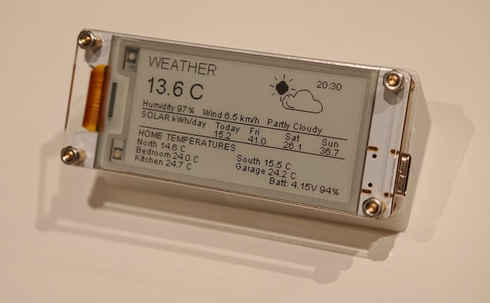
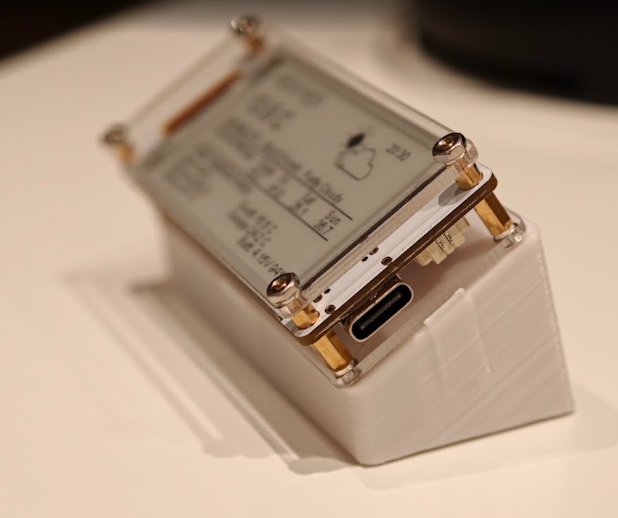
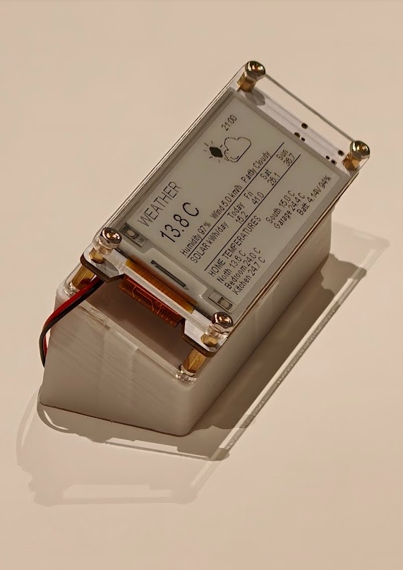
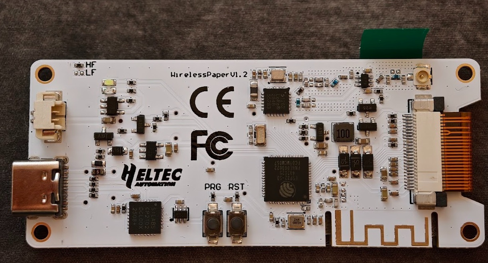
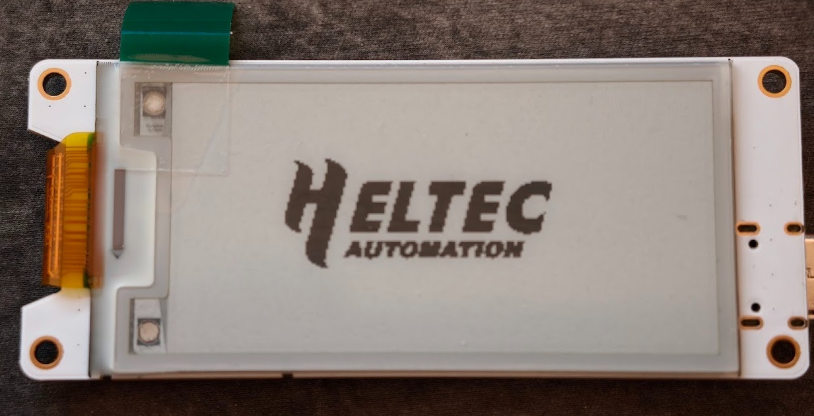

# Heltec Wireless Paper Weather Station

<p align="center">
  
</p>

A battery-powered weather station based on the **Heltec Wireless Paper V1.2** ESP32-S3 board and its E0213A367 e-paper display.

The firmware retrieves current weather conditions from [Open-Meteo](https://open-meteo.com/) and reads solar forecasts and temperature values from a local Home Assistant installation.

## Features

- Current outdoor temperature, humidity, wind speed and weather condition
- Weather icons drawn on the e-paper display
- Solar forecast for today and the next three days via Home Assistant
- Five configurable Home Assistant temperature readings
- Battery voltage and approximate battery percentage
- Wi-Fi with optional secondary network
- NTP time synchronisation
- Deep-sleep operation between updates

The current firmware schedule is configured for 90-minute daytime updates and 2-hour updates overnight (00:00–06:00). Check the sleep-scheduling code before changing this behaviour.

## Hardware

- Heltec Wireless Paper V1.2
- ESP32-S3
- E0213A367 e-paper display
- 3.7 V Li-Po battery (the example build used a 500 mAh cell)
- USB-C programming cable

### 3D-printed enclosure

The weather station is mounted in a custom 3D-printed enclosure designed for this build. The design is available on Thingiverse:

**[View and download the 3D-printed enclosure on Thingiverse](https://www.thingiverse.com/thing:7413846)**

### Project photos

| Completed weather station | Enclosure and USB-C access |
|---|---|
|  |  |

| Assembled station – alternate angle | Heltec Wireless Paper V1.2 board |
|---|---|
|  |  |

| E-paper display module |
|---|
|  |

### GPIO assignments used by this firmware

| Function | GPIO |
|---|---:|
| Display CLK | 3 |
| Display MOSI | 2 |
| Display CS | 4 |
| Display DC | 5 |
| Display RESET | 6 |
| Display BUSY | 7 |
| Battery ADC | 20 |
| Battery measurement enable | 19 |
| Vext control | 45 |

Display initialisation in the sketch:

```cpp
HT_E0213A367 display(6, 5, 4, 7, 3, 2, -1, 6000000);
```

**Battery safety:** Verify connector polarity before connecting a Li-Po cell. Use suitable charging/protection circuitry. Do not puncture, crush, compress or tightly seal the battery in an enclosure. The displayed battery percentage is a voltage-based estimate, not a fuel-gauge measurement.

## Software requirements

- Arduino IDE
- ESP32 board support for ESP32-S3
- The Heltec display library/header providing `HT_E0213A367.h`
- Standard ESP32 libraries used by the sketch

Install the display library appropriate for your board revision. Library versions may affect compatibility.

## Installation

1. Download or clone this repository.
2. Open `Weather_Station_2026.ino` in Arduino IDE.
3. In the same sketch folder, copy:
   - `secrets.example.h` to `secrets.h`
   - `sensors.example.h` to `sensors.h`
4. Edit `secrets.h` with your Wi-Fi credentials, approximate coordinates, Home Assistant host, port and access token.
5. Edit `sensors.h` with entity IDs from your own Home Assistant instance.
6. Select the correct ESP32-S3 board and port in Arduino IDE.
7. Compile and upload.

The sketch includes `secrets.h` and `sensors.h`; both local files must exist beside the `.ino` file when compiling.

## Configure Home Assistant entities

The firmware reads nine values using one Home Assistant `/api/template` request:

- Four solar forecast values
- Five temperature values

The four solar entity IDs and five temperature entity IDs belong in `sensors.h`. The example entity IDs are placeholders and must be replaced.

This project was developed using Solcast forecast sensors exposed through Home Assistant. Other numeric forecast sensors can be used if their units are appropriate for the display.

All nine Home Assistant entity IDs are configured in `sensors.h`. The public sketch uses configuration macros from that file, so you do not need to edit the `.ino` file to change your own sensor names.

The example file contains placeholder entity IDs. Replace them with the exact entity IDs from your Home Assistant installation.

## Security

- The device accesses Home Assistant through its local HTTP API.
- Use a dedicated Home Assistant long-lived access token for this device.
- Treat the token as a password; anyone who obtains it may be able to access Home Assistant with its permissions.
- Do not expose Home Assistant's API to the public internet for this project.
- Never commit `secrets.h`, Wi-Fi credentials, access tokens or precise home coordinates.
- Keep `HA_HOST` as a local address reachable from the ESP32's Wi-Fi network.

## Open-Meteo

Current weather data comes from the Open-Meteo forecast API. No API key is configured in this project.

Documentation: https://open-meteo.com/en/docs

## Suggested repository layout

The Arduino sketch folder must have the same name as the `.ino` file:

```text
Heltec-Weather-Station/
├── README.md
├── .gitignore
├── images/
│   ├── weather-station-main.jpg
│   ├── enclosure-usb-view.jpg
│   ├── assembled-weather-station-angle.jpg
│   ├── wireless-paper-board.jpg
│   └── e-paper-display-module.jpg
└── Weather_Station_2026/
    ├── Weather_Station_2026.ino
    ├── secrets.example.h
    └── sensors.example.h
```

When setting up your own device, copy the two example headers inside the sketch folder:
- `secrets.example.h` → `secrets.h`
- `sensors.example.h` → `sensors.h`

Keep the real `secrets.h` and `sensors.h` local. The `.gitignore` excludes both files from Git.

## Troubleshooting

- **Wi-Fi does not connect:** check SSID/password and signal strength.
- **Home Assistant request fails:** check local host, port, token and network reachability.
- **Sensor values are zero or incorrect:** verify entity IDs and confirm the Home Assistant states are numeric.
- **Weather request fails:** check Wi-Fi and Open-Meteo connectivity.
- **Display does not initialise:** verify board revision, wiring and display library version.

## License

Add a `LICENSE` file before inviting others to reuse or redistribute the code. An MIT licence is a common permissive option if that matches your intentions.
